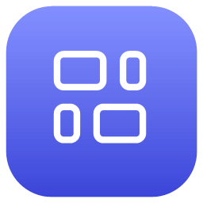
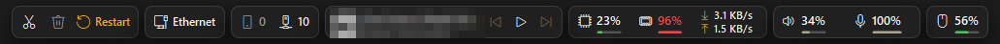
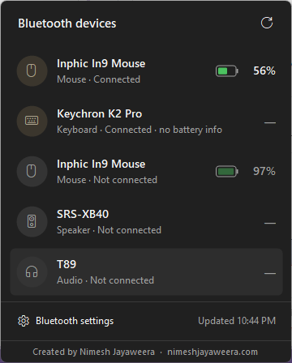
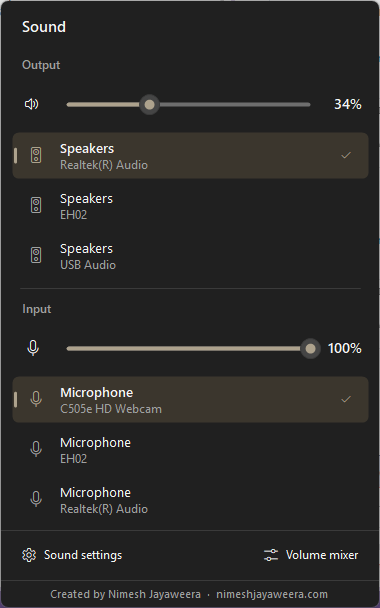
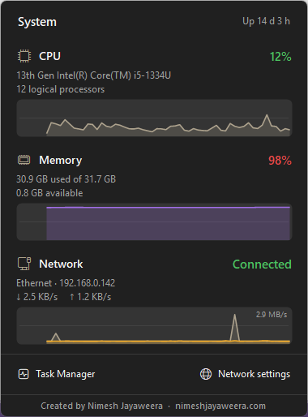
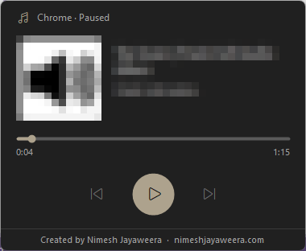
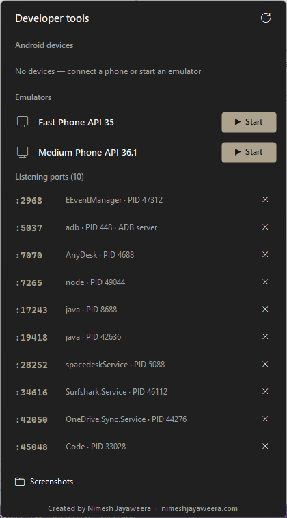
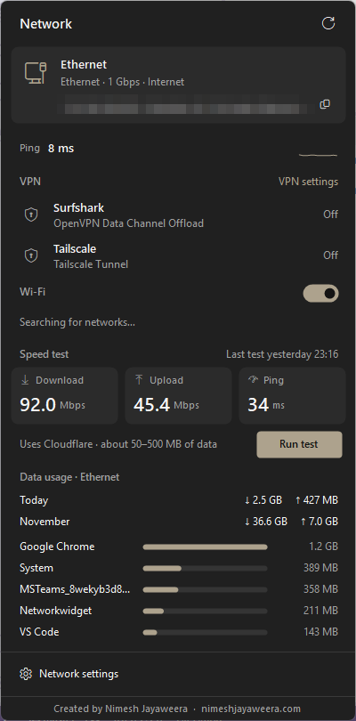
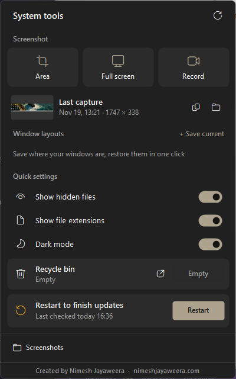
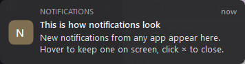

<p align="center">
  
</p>

<h1 align="center">Taskbar Widgets for Windows</h1>

<p align="center">
  Small, native widgets that live right on the Windows taskbar: battery, sound, system stats, media, network, developer tools, quick system tools and macOS-style notifications.
</p>

<p align="center">
  <a href="../../releases/latest"></a>
  <a href="../../actions/workflows/release.yml"></a>
  
  <a href="LICENSE"></a>
</p>

<p align="center">
  
</p>

---

## Contents

- [Download and install](#download-and-install)
- [The widgets](#the-widgets)
  - [Bluetooth Battery](#bluetooth-battery)
  - [Audio Control](#audio-control)
  - [System Monitor](#system-monitor)
  - [Now Playing](#now-playing)
  - [Developer Tools](#developer-tools)
  - [Network](#network)
  - [System Tools](#system-tools)
  - [Notifications](#notifications)
- [Works on every taskbar](#works-on-every-taskbar)
- [Build from source](#build-from-source)
- [Making a release](#making-a-release)

## Download and install

Get the latest files from the [**Releases**](../../releases/latest) page.

| File | Use it when |
|---|---|
| `TaskbarWidgets-x.y.z-x64.msi` | **Recommended.** Installs every widget, adds them to the Start menu and starts them. No admin rights needed. Uninstall from *Settings → Apps*. |
| `<Widget>-x.y.z-win-x64.exe` | You only want one widget. A single portable file: download and run it. |
| `TaskbarWidgets-x.y.z-win-x64-portable.zip` | You want all widgets without installing. Unzip anywhere and run the ones you like. |

**Requirements:** Windows 10 (version 2004 or later) or Windows 11, 64-bit. Everything is self-contained, so you don't need to install .NET.

> [!NOTE]
> The downloads are not code-signed yet, so Windows SmartScreen may show *"Windows protected your PC"*. Click **More info → Run anyway**.

Each widget has a tray icon. **Right-click it** (or the widget on the taskbar) for its options, including **Start with Windows** and **Exit**. Don't want a widget? Exit it and turn off *Start with Windows*.

## The widgets

### Bluetooth Battery



See the battery level of your Bluetooth mouse, keyboard, headphones and other devices right on the taskbar.

- Battery percentage and a coloured level bar for each connected device
- Click to open a panel that lists every paired device with its type, connection state and last known battery level
- **Low battery alert** when a device drops below a level you choose
- Hover for a quick summary card
- A tray icon for each device (optional)

<br clear="right">

### Audio Control



Volume and microphone at a glance, plus fast device switching.

- Speaker volume and microphone level on the taskbar
- **Microphone status**: a red dot when the mic is live, *Muted* when Windows or your call app (such as Teams) has it muted
- **Scroll** on the widget to change the volume; **middle-click** to mute
- Middle-click the mic to mute it; in a Teams call this mutes the call itself
- Panel with output and input volume sliders and one-click switching between speakers, headphones and microphones
- Shortcuts to Sound settings and the Volume mixer

<br clear="right">

### System Monitor



Live CPU, memory and network activity without opening Task Manager.

- CPU %, memory % and download/upload speed on the taskbar, each with a small meter
- Panel with live graphs, processor name, memory used and available, local IP address and uptime
- Choose what to show in the widget, how often it refreshes, and network units (bytes or bits)
- One click to open Task Manager or Network settings

<br clear="right">

### Now Playing



Control whatever is playing (Spotify, YouTube in your browser, Media Player and others) from the taskbar.

- Title, artist and artwork on the taskbar with previous / play-pause / next buttons
- **Middle-click** to play or pause
- Panel with large artwork, a progress bar and playback controls
- Open the playing app in one click
- Adjustable title width

<br clear="right">

### Developer Tools



A small control centre for Android and web developers.

- Connected Android devices and emulators at a glance (needs the Android SDK `adb`)
- Start any Android emulator in one click and start the ADB server
- **Listening ports**: see which app is using each local port, and stop it with one click
- Quick access to your screenshots folder

<br clear="right">

### Network



Everything about your connection in one place.

- Connection name (Wi-Fi or Ethernet) or ping on the taskbar
- Public IP address, location and provider, with a copy button
- Live **ping** graph
- **VPN**: connect and disconnect your Windows VPN connections
- **Wi-Fi**: turn it on or off, see nearby networks, join one, and share the current network as a QR code
- **Speed test** (download, upload and ping) using Cloudflare
- **Data usage** today and this month, plus the apps using the most data

<br clear="right">

### System Tools



Handy Windows shortcuts that are normally buried in Settings.

- **Screenshot** an area or the full screen; copy the last capture or open its folder
- **Window layouts**: save where your windows are and restore them in one click
- **Quick settings**: show hidden files, show file extensions, dark mode
- **Recycle bin** size, open it or empty it
- **Windows Update** status, with a *Restart* button when an update is waiting

<br clear="right">

### Notifications



Shows Windows notifications as clean, macOS-style banners.

- Rounded banners with the app icon, name, title and message; they slide in and fade out
- **Position**: top right (default), top centre, top left, bottom right or bottom left
- Choose how long banners stay on screen; hover to keep one open, click to open the app, × to close
- **Sounds per app**: automatic (silent if the app already played its own sound), none, a Windows sound or your own `.wav` file
- Turn banners off for specific apps
- Tip: turn on Windows **Do not disturb** so you don't also get Windows' own pop-ups. The widget's menu has a shortcut for this.

## Works on every taskbar

All the taskbar widgets share the same behaviour:

- **Line up automatically** next to each other near the system tray, and move when one gets wider
- **Small screens**: when the taskbar runs out of room, widgets shrink to a single icon (click it for the full panel) or hide, so they never cover your app icons
- **Hide in full screen** for games, videos and presentations
- **Light and dark** themes follow Windows
- **Drag** a widget anywhere; right-click → *Reset widget position* to snap it back
- Each widget is its own small app, so run only the ones you want

## Build from source

You need the [.NET 8 SDK](https://dotnet.microsoft.com/download/dotnet/8.0) on Windows.

```powershell
git clone https://github.com/nimeshc64/windows-taskbar-widgets.git
cd windows-taskbar-widgets

# run one widget
dotnet run --project src/NetworkWidget

# build every download (exe files, portable zip and MSI) into .\dist
./build.ps1 -Version 1.0.0
```

```
src/
  BluetoothBatteryWidget/   also holds the shared code (taskbar docking, theme, panels)
  AudioControlWidget/
  SystemMonitorWidget/
  NowPlayingWidget/
  DevToolsWidget/
  NetworkWidget/
  SystemToolsWidget/
  NotificationsWidget/
installer/                  WiX installer (MSI)
build.ps1                   builds every release file
```

## Making a release

Releases are built by GitHub Actions ([`release.yml`](.github/workflows/release.yml)). Push a version tag:

```powershell
git tag v1.0.0
git push origin v1.0.0
```

The workflow builds the 8 single-file exes, the portable zip and the MSI installer, then publishes them on a new GitHub release. You can also start it by hand from the **Actions** tab (*Release → Run workflow*) and type a version.

## License

[MIT](LICENSE)

---

<p align="center">
  Created by <a href="https://nimeshjayaweera.com/"><b>Nimesh Jayaweera</b></a> · <a href="https://nimeshjayaweera.com/">nimeshjayaweera.com</a>
</p>
